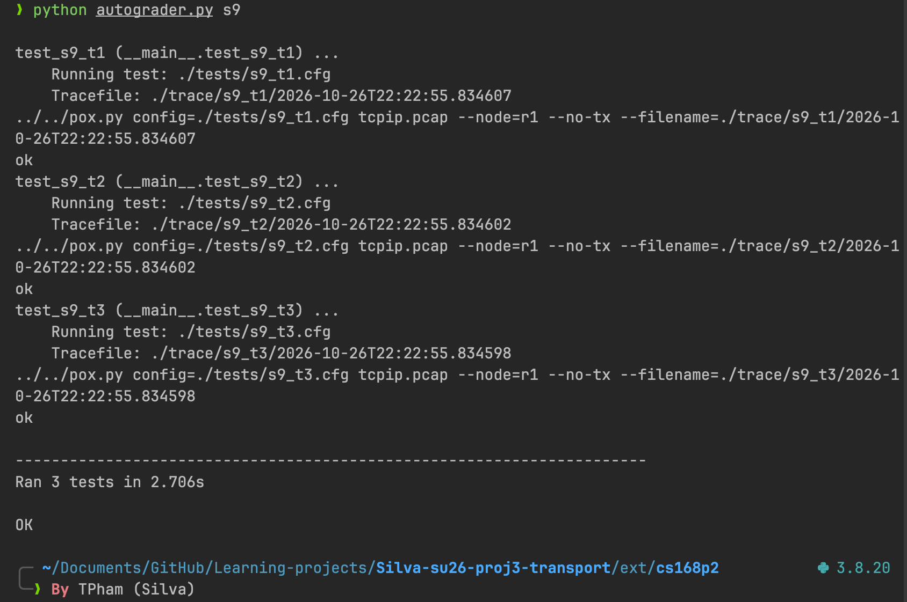

# TCP/IP Transport Project

Network simulator code from [https://github.com/noxrepo/pox](https://github.com/noxrepo/pox). See that repo for licensing information.

To run all the tests:
```
python autograder.py all
```

### Result:


### Implementation file:
[student_socket.py](./tcp-ip/ext/cs168p2/student_socket.py)
