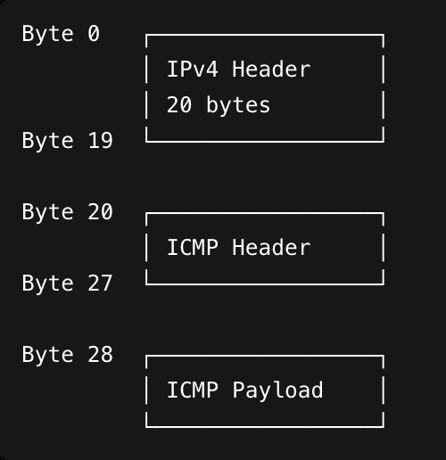
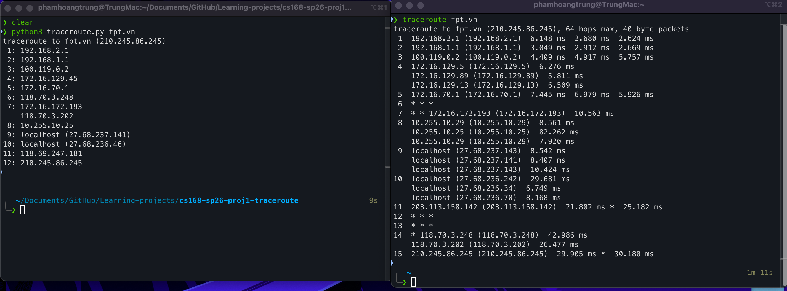

# CS168 Traceroute Project

See https://cs168.io/proj1/ for the spec.

My implementation of the traceroute utility is in `traceroute.py`. To run it, use the command line as follows:

```bash
python traceroute.py <destination_ip_or_hostname>
```

# Notes
## 1) sample ipv4-icmp packet layout


## 2) results
